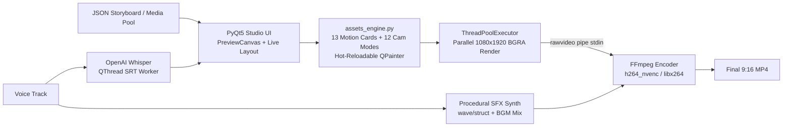
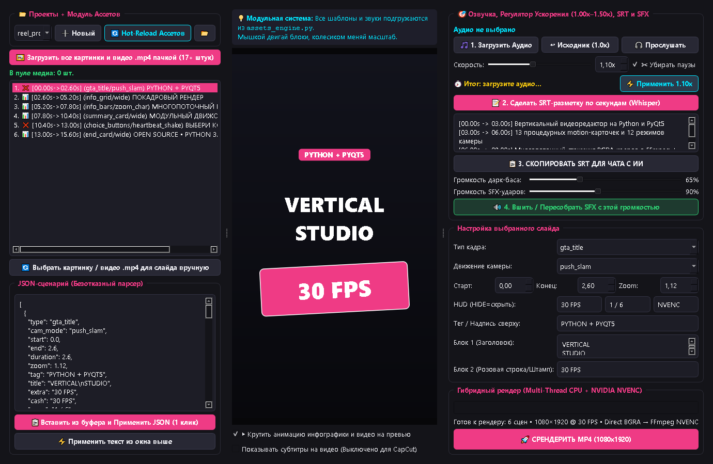
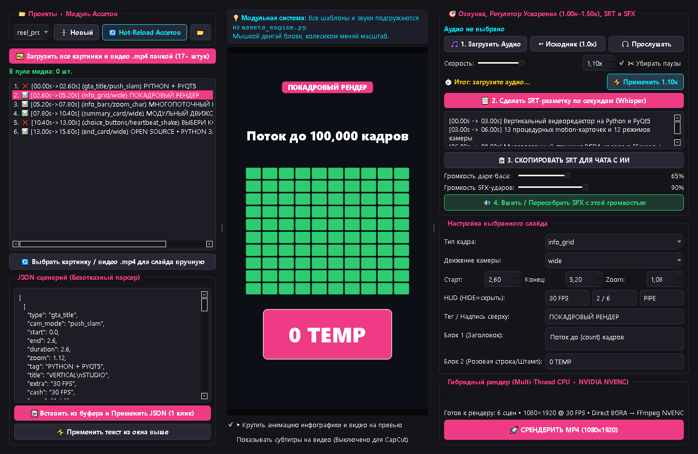
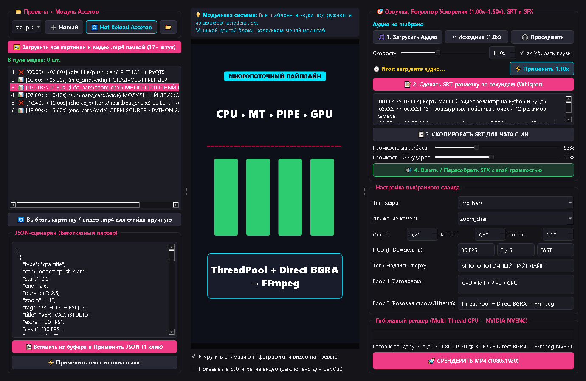
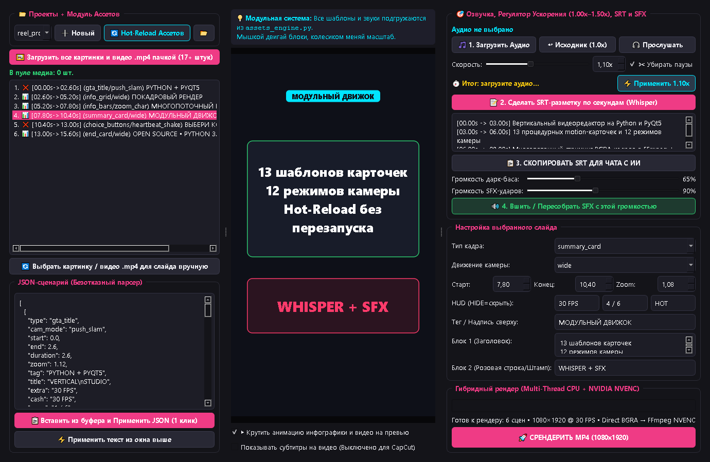

https://github.com/user-attachments/assets/73793205-90f4-4334-a75b-1f5b0b069eac

# 🎬 Vertical Video Studio PRO — Procedural Motion & FFmpeg Engine

Десктопный видеоредактор и процедурный motion-движок на **Python + PyQt5 + QPainter + FFmpeg + Whisper** для быстрой сборки вертикальных видео (**1080×1920 @ 30 FPS**) без ручного монтажа рутинных плашек и переходов.


---

## 🎬 Видеодемонстрация

📹Смотреть видео:

https://github.com/user-attachments/assets/764d9041-caef-4883-9658-b38b64e47f62


*(Для GitHub: при редактировании `README.md` на сайте перетащите `assets/demo.mp4` в текст **отдельным абзацем с пустыми строками сверху и снизу** — GitHub заменит ссылку на встроенный видеоплеер.)*

---

## ✨ Ключевые возможности

- **🎨 Процедурный 2D-движок (`assets_engine.py`) с Hot-Reload** — 13 встроенных анимированных motion-карточек (`gta_title`, `info_grid`, `info_bars`, `info_meter`, `rule_card`, `summary_card`, `choice_buttons`, `end_card` и др.) и 12 режимов движения камеры (`push_slam`, `heartbeat_shake`, `dutch_tilt`, `pan_left/right`, `zoom_char` и т.д.) на `QPainter` с easing-кривыми (`ease_out_cubic`, `ease_out_back`). Движок можно править и перезагружать на лету прямо в запущенной программе (`importlib.reload`).
- **⚡ Zero-Temp-File FFmpeg Pipeline (`RenderWorker`)** — многопоточный рендер кадров через `ThreadPoolExecutor` с прямой потоковой передачей сырых `BGRA`-кадров в `stdin` процесса `ffmpeg` (без сохранения тысяч временных PNG на диск) и автоматическим определением аппаратного ускорения **NVIDIA NVENC (`h264_nvenc`)** с откатом на `libx264`.
- **🖱 Интерактивный Canvas (`PreviewCanvas`)** — предпросмотр анимации в реальном времени (9:16), перетаскивание и масштабирование колёсиком мыши HUD-панели, заголовков, плашек и субтитров прямо поверх кадра.
- **🎙 Автоматическая обработка звука и AI-субтитры** — локальное распознавание речи через **OpenAI Whisper** (`WhisperSRTWorker` в отдельном `QThread`), генерация таймкодов `.srt`, ускорение речи + вырезание пауз через FFmpeg audio-фильтры.
- **🔊 Процедурный синтез SFX на чистом Python** — генерация звуковых эффектов (свипы, акценты, удары) средствами стандартной библиотеки (`wave`, `struct`, `math`) и автоматическое микширование с озвучкой и фоновой музыкой.
- **🧩 JSON-сценарии** — импорт и редактирование всей раскадровки в JSON (готовый пример — `examples/demo_project.json`).

---

## 🏗 Архитектура пайплайна



---

## 📸 Интерфейс и процедурные карточки

### Главный экран студии (Title Card & Live Preview)


### Процедурные инфографики и карточки
| Info Grid (счётчик + матрица) | Info Bars (анимированный график) | Summary Card |
|---|---|---|
|  |  |  |

---

## 🚀 Установка и запуск

Требуется **Python 3.10+** и установленный **FFmpeg** (`ffmpeg` и `ffprobe` в `PATH`).

```bash
git clone https://github.com/vztyz/vertical-video-studio.git
cd vertical-video-studio
python -m venv venv

# Windows:
venv\Scripts\activate
# Linux / macOS:
source venv/bin/activate

pip install -r requirements.txt
python main.py
```

Для быстрого знакомства скопируйте `examples/demo_project.json` в папку `projects/` и выберите проект `demo_motion_reel` в выпадающем списке студии (или вставьте массив `slides` прямо в JSON-редактор справа).

---

## 📁 Структура проекта

```text
vertical-video-studio/
├── main.py                      # Десктопная студия PyQt5, PreviewCanvas, WhisperSRTWorker, RenderWorker
├── assets_engine.py             # Hot-Reloadable 2D motion-движок (13 карточек, 12 камер) + синтез SFX
├── examples/demo_project.json   # Демо-сценарий (6 анимированных сцен)
├── assets/                      # Скриншоты интерфейса и видеодемонстрация (demo.mp4)
├── requirements.txt             # Зависимости (PyQt5, openai-whisper)
└── .gitignore                   # Исключение projects/, рендеров *.mp4/*.wav и кэша
```
